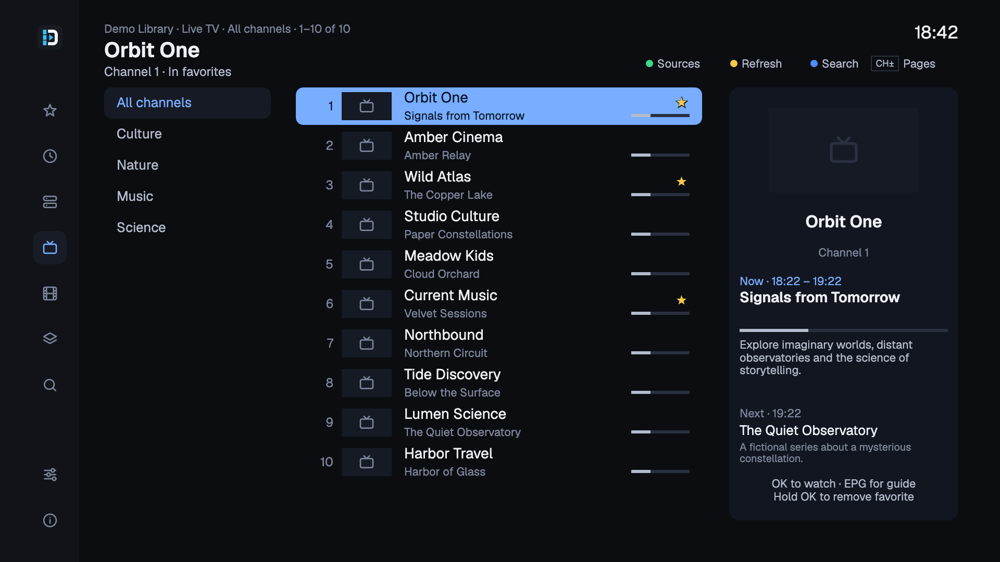
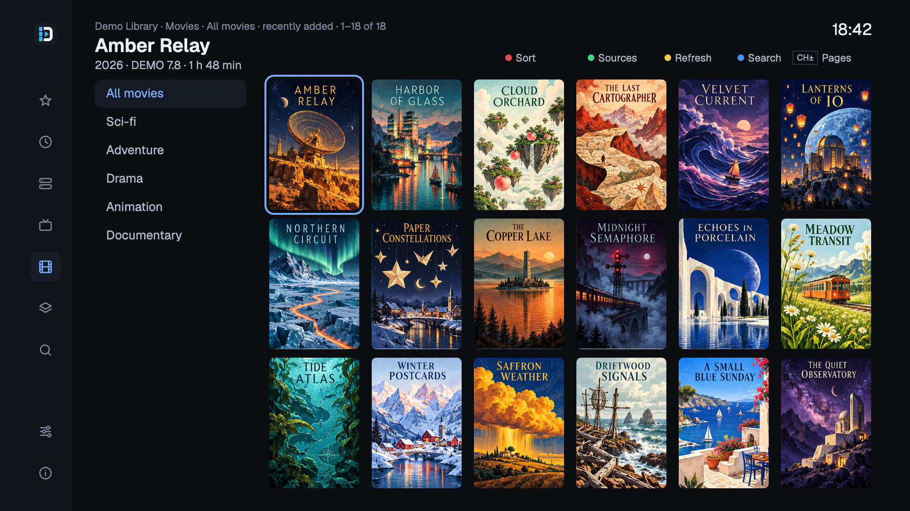
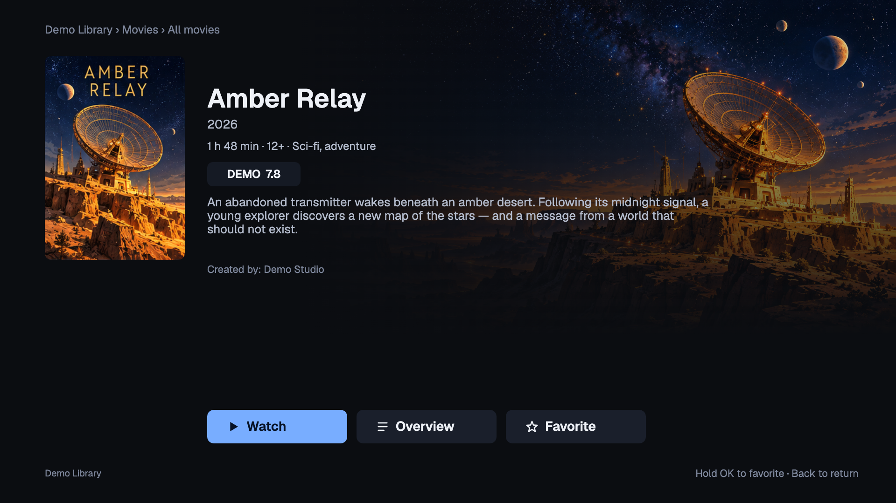

<h1 align="center">
  
</h1>

<p align="center">
  IPTV for your Enigma2 receiver.
</p>

<p align="center">
  <a href="https://github.com/4gray/dreaminator/releases"></a>
  <a href="https://github.com/4gray/dreaminator/actions/workflows/ci.yml"></a>
  <a href="LICENSE"></a>
  
  
</p>

<p align="center">
  <a href="docs/installation.md">Installation</a> ·
  <a href="docs/screenshots.md">Screenshot gallery</a> ·
  <a href="docs/features.md">Features &amp; remote control</a> ·
  <a href="docs/development.md">Development</a>
</p>

[](docs/screenshots.md#live-tv)

Dreaminator lets you organize IPTV channels on your tablet and watch them on your Enigma2 receiver. Add an **M3U playlist, Xtream Codes account or Stalker/Ministra portal**, choose your channels, and send them to the TV. They appear in the usual channel list alongside your satellite channels.

On the TV, use your remote to see what's on, check the programme guide, or open your favorites. If your Stalker portal includes films and series, you can browse those too, with posters, descriptions, seasons and episodes.

- Arrange channels and bouquets from your tablet, phone or computer.
- Keep favorite channels, films and series together, and find recently opened items.
- Add XMLTV guides and channel logos, or watch available M3U catch-up programmes.
- Edit receiver bouquets with drafts, copies and undo before saving to the TV.

[Features and remote controls →](docs/features.md)

<p align="center">
  <a href="docs/screenshots/movies.png"></a>
  <a href="docs/screenshots/movie-details.png"></a>
</p>

[More screenshots →](docs/screenshots.md)

## Installation

Version **0.11.2** is ready as a release draft. While publication is pending, you can [build it from source](docs/development.md). The last published version, 0.6.0, does not include the TV catalog shown here.

1. **Choose the package for your receiver** from [GitHub Releases](https://github.com/4gray/dreaminator/releases) when 0.11.2 is published:

   | Receiver / tested image | Package |
   | --- | --- |
   | **Dreambox DM520** / OpenHDF 6.4 build 137 | `dreaminator_0.11.2_all.ipk` · MIPS little-endian |
   | **Vu+ Uno 4K SE** / openATV 7.5 | `dreaminator_0.11.2_vuuno4kse.ipk` · ARMv7 |

2. **Install the matching IPK** from a FAT32 USB drive through **Menu → Setup → Software management → Install local extension**, then accept the GUI restart. [SSH installation and checksums →](docs/installation.md#install-the-package)
3. **Open** `http://<receiver-address>:8088` on your tablet, or scan the QR code in **Menu → Plugins → Dreaminator → Settings**.
4. **Add a source**, choose channels or groups, and select **Send to TV**. The TV catalog can browse your source independently of bouquet selection.

The app currently uses Russian labels; the previews above use English.

**[Full setup and troubleshooting](docs/installation.md)** · **[Windows walkthrough (PDF)](docs/Dreaminator-install-Windows.pdf)** · **[Vu+ installation](docs/installation.md#vu-uno-4k-se--openatv-75)**

<details>
<summary><strong>Receiver compatibility and requirements</strong></summary>

| Component | Current support |
| --- | --- |
| Dreambox DM520 | Tested on OpenHDF 6.4 build 137, Linux 3.4, Python 2.7.15 |
| Vu+ Uno 4K SE | Tested by the maintainer on openATV 7.5; separate ARMv7 package |
| TV layouts | Full HD 1920×1080 on DM520; HD 1280×720 on the maintainer's Vu+ setup |
| Other receivers/images | Unverified, including other MIPS/ARM/ARM64 receivers and stock DreamOS |
| Receiver integration | OpenWebif for controls; EPGImport for the native channel-list/infobar guide |
| Web interface | Tablet, phone or desktop browser on the receiver's trusted home network |

The `_all.ipk` is the legacy DM520 package name: it contains a **MIPS little-endian, soft-float** executable. It is not a universal package. The Vu+ package contains a **32-bit ARMv7** executable. Do not interchange them. Both share the Python plugin and HD/Full HD artwork; the harness covers Python 2.7 and 3.

Tested image versions are compatibility baselines; you do not need to reflash a working receiver merely to match them. Playback depends on the receiver, image and provider. The DM520's [manufacturer specification](https://dreambox.de/download/Dreambox_DM520_QuickGuide_122016.pdf) lists HEVC up to Full HD. See the [roadmap](ROADMAP.md) for remaining audio, seeking and physical-remote checks.

</details>

<details>
<summary><strong>Which sources support movies and catch-up?</strong></summary>

| Source | Live TV | Movies / series | Catch-up |
| --- | --- | --- | --- |
| M3U URL / file | Yes | Planned | Supported M3U archive attributes |
| Xtream account | Yes | Planned | Planned |
| Stalker / Ministra | Yes | Yes | Planned |

M3U archive URL modes include `shift`, `append`, `default`, `flussonic` and `xc`. Provider retention and actual recording availability vary. Resume, watched flags, automatic next episode, downloads and cross-source search are planned. Dreaminator does not transcode media.

To open catch-up from receiver bouquets, select a channel and choose **Menu → Dreaminator Archive** (shown as **Архив Dreaminator** in the current interface). The optional EPG-button shortcut is also included. [Catch-up setup →](docs/installation.md#catch-up-from-receiver-channel-lists)

</details>

<details>
<summary><strong>Where are settings stored, and how does the TV integration work?</strong></summary>

The Go service serves the web interface and JSON API. The Python plugin renders native TV screens and hands streams to Enigma2's player. OpenWebif handles bouquet reloads and tuning; EPGImport loads filtered programmes. Stalker streams use fresh resolved links, and media goes directly to the player.

Settings and caches live in `/etc/dreaminator/`. The receiver-bouquet editor saves only when explicitly requested. The web interface has no login: keep port 8088 on your trusted home network.

[Architecture, file paths and simulator →](docs/development.md)

</details>

## Development

Use **Go 1.26.10+**. Build packages with `make ipk` (Dreambox) or `make ipk-vuuno4kse` (Vu+).

```sh
make dev          # local web interface on :8088
make test         # Go vet + Go tests + Node regression tests
make sim          # virtual MIPS Dreambox in Docker
make plugin-test  # Python 2.7/3 plugin and simulator integration
```

Found a problem? Include the receiver model, image/build, Dreaminator version and steps to reproduce. Redact provider credentials, MAC addresses, stream URLs and API keys.

[Contributing](CONTRIBUTING.md) · [Development](docs/development.md) · [Roadmap](ROADMAP.md) · [Security](SECURITY.md)

---

**Content disclaimer.** Dreaminator is a media player and playlist manager. The project does not provide, host or sell TV channels, films, streams, playlists, subscriptions or access credentials. You supply your own sources and must have the rights or permission to use them. You are responsible for complying with applicable laws and your provider's terms. Dreaminator is not affiliated with third-party content providers and does not endorse copyright infringement or unauthorized access.

[MIT licensed](LICENSE). [Third-party notices](THIRD_PARTY_NOTICES.md) · [Geist font license](plugin/Dreaminator/fonts/OFL.txt)

*This product uses the TMDB API but is not endorsed or certified by TMDB.*
