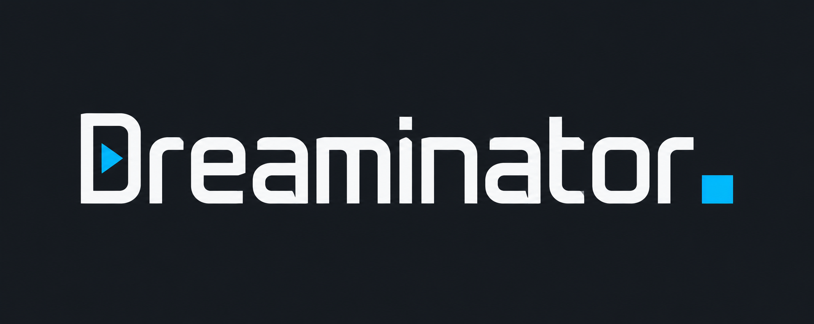

<h1 align="center">
  
</h1>

<p align="center">
  <strong>Your IPTV, at home on your Enigma2 receiver.</strong><br>
  Organize channels from your tablet. Browse and watch with your remote.
</p>

<p align="center">
  <a href="https://github.com/4gray/dreaminator/releases/latest"></a>
  <a href="https://github.com/4gray/dreaminator/actions/workflows/ci.yml"></a>
  <a href="LICENSE"></a>
  
  
</p>

<p align="center">
  <a href="docs/installation.md">Installation</a> ·
  <a href="docs/features.md">Features &amp; remote control</a> ·
  <a href="docs/development.md">Development</a> ·
  <a href="ROADMAP.md">Roadmap</a>
</p>

---

Dreaminator brings **M3U, Xtream Codes and Stalker/Ministra** to an Enigma2 receiver. Install one package, open the web interface on your tablet, and build the channel lists you want. Send them to the TV as ordinary bouquets alongside your satellite channels.

On the TV, a native full-screen catalog gives you live channels, programme guides, favorites and recent items. Stalker portals also provide movies and series, with optional TMDB descriptions and artwork. No browser engine runs on the receiver.

## A better way to manage your TV

- **Set up from the sofa.** Add a playlist URL, upload M3U, or connect a provider account. Star channels and drag lists into order on a tablet, phone or computer.
- **Keep the familiar channel list.** Send selected channels to ordinary Enigma2 bouquets. Tune a channel from your tablet, or edit existing receiver bouquets with drafts, copies and undo.
- **Browse with your remote.** Native poster grids, live TV, search, favorites and recents. Return from playback to the same card and the channel you were watching before.
- **Give channels their guide and logo.** XMLTV filtering, EPGImport integration and automatically generated picons. Play available M3U catch-up programmes from the guide.
- **Let the receiver do the routine work.** Overnight playlist/guide refresh, subscription expiry notices and on-demand stream checks.

[Explore all features and remote controls →](docs/features.md)

## Compatibility

| Component | Current support |
| --- | --- |
| **Tested receiver** | **Dreambox DM520** |
| **Tested image** | **OpenHDF 6.4 build 137**, Linux 3.4, Python 2.7.15 |
| **Recommended Dreaminator build for this setup** | **0.11.2**, available from GitHub Releases |
| TV layout | Full HD 1920×1080 on DM520; HD 1280×720 on the maintainer’s Vu+ setup |
| Other MIPS Enigma2 receivers/images | Unverified; compatibility depends on image, Python, player and plugins |
| Vu+ Uno 4K SE / openATV 7.5 | Tested on a receiver by the maintainer; separate **ARMv7** package |
| Other ARM/ARM64 receivers and stock DreamOS | Unverified; neither package certifies these configurations |
| Browser | Tablet, phone or desktop browser on the receiver's home network |

The default `_all.ipk` contains a **MIPS little-endian, soft-float** executable. The separate `_vuuno4kse.ipk` contains a **32-bit ARMv7** executable and declares the receiver's machine architecture. Both builds share the same Python plugin and HD/FHD assets. Python 2.7 and 3 are covered by the plugin harness; this does not certify every image. OpenWebif is required for receiver controls; EPGImport is needed for the native channel-list/infobar guide.

> **Choose the right package.** Download **0.11.2** from [Releases](https://github.com/4gray/dreaminator/releases/latest). The `_all.ipk` is for **Dreambox DM520 (MIPS)**; `_vuuno4kse.ipk` is for **Vu+ Uno 4K SE (ARMv7)**. They are not interchangeable. The tested image versions are compatibility baselines; you do not need to reflash a working receiver merely to match them. The old 0.6.0 release predates the startup fixes, TV catalog and catch-up.

Playback depends on the receiver, image and provider. The DM520's [manufacturer specification](https://dreambox.de/download/Dreambox_DM520_QuickGuide_122016.pdf) lists HEVC up to Full HD. See the [roadmap](ROADMAP.md) for remaining audio, seeking and physical-remote checks.

> **Archive from bouquets:** choose a channel, press **Menu → Архив Dreaminator**. The existing EPG-button shortcut is also included; see [setup](docs/installation.md#catch-up-from-receiver-channel-lists). The PDF is a general guide; use the online instructions for current package names.

## Quick start

1. **Download [Dreaminator 0.11.2](https://github.com/4gray/dreaminator/releases/tag/v0.11.2)** for your receiver:

   | Receiver | Release asset |
   | --- | --- |
   | Dreambox DM520 / OpenHDF 6.4 | `dreaminator_0.11.2_all.ipk` — MIPS little-endian |
   | Vu+ Uno 4K SE / openATV 7.5 | `dreaminator_0.11.2_vuuno4kse.ipk` — ARMv7 |

2. **Install the matching IPK** from a FAT32 USB drive through **Menu → Setup → Software management → Install local extension**, then accept the GUI restart. For SSH installation and checksums, follow the [setup guide](docs/installation.md#install-the-package).
3. **Open** `http://<receiver-address>:8088` on your tablet, or scan the QR code in **Menu → Plugins → Dreaminator → Settings**.
4. **Add a source**, choose channels or groups, then select **Send to TV**. The TV catalog can browse your source independently of bouquet selection.

**[Full setup and troubleshooting](docs/installation.md)** · **[Windows walkthrough (PDF)](docs/Dreaminator-install-Windows.pdf)** · **[Printable HTML](docs/install-windows.html)**

For source builds, use [Go 1.26.10+](docs/development.md#toolchain) and `make ipk` (Dreambox) or `make ipk-vuuno4kse` (Vu+). The ordinary `make deploy` and simulator target DM520/MIPS. See the [Vu+ installation steps](docs/installation.md#vu-uno-4k-se--openatv-75).

Application labels currently use **Russian**; documentation is in English. The web interface has no login and is intended for a trusted home network. Keep port 8088 private to that network.

<details>
<summary><strong>Which sources support movies and catch-up?</strong></summary>

| Source | Live TV | Movies / series | Catch-up |
| --- | --- | --- | --- |
| M3U URL / file | Yes | Planned | Supported M3U archive attributes |
| Xtream account | Yes | Planned | Planned |
| Stalker / Ministra | Yes | Yes | Planned |

M3U archive URL modes include `shift`, `append`, `default`, `flussonic` and `xc`. Provider retention and actual recording availability vary. Resume, watched flags, automatic next episode, downloads and cross-source search are planned. Dreaminator does not transcode media.

</details>

<details>
<summary><strong>How does Dreaminator fit into Enigma2?</strong></summary>

A small Go service runs on the receiver and serves the tablet interface and JSON API. A Python plugin renders native TV screens and hands streams to Enigma2's player. OpenWebif handles bouquet reloads and tuning; EPGImport loads filtered programmes. Stalker streams use fresh resolved links, and media goes directly to the player.

Settings and caches live in `/etc/dreaminator/`. The separate receiver-bouquet editor saves only when explicitly requested. [Architecture, file paths and simulator →](docs/development.md)

</details>

## Build, test and contribute

```sh
make dev          # local web interface on :8088
make test         # Go vet + Go tests + Node regression tests
make sim          # virtual MIPS Dreambox in Docker
make plugin-test  # Python 2.7/3 plugin and simulator integration
```

Bug reports are most useful with the receiver model, image/build, Dreaminator version and steps to reproduce. Redact provider credentials, MAC addresses, stream URLs and API keys. See the [development guide](docs/development.md) and [roadmap](ROADMAP.md) for implementation details and work ahead.

The project is licensed under [MIT](LICENSE). See [Contributing](CONTRIBUTING.md), [Security](SECURITY.md) and [third-party notices](THIRD_PARTY_NOTICES.md).

Geist fonts are bundled under the [SIL Open Font License](plugin/Dreaminator/fonts/OFL.txt). Optional metadata comes from TMDB.

*This product uses the TMDB API but is not endorsed or certified by TMDB.*
