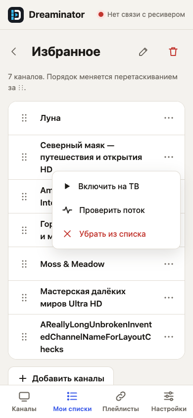

# Responsive channel lists

This focused audit and adaptation preserves the existing Russian interface, colors, typography and navigation. Captures below show the current Go service with temporary invented channel and playlist fixtures. Receiver access and nightly refresh are disabled; the offline receiver indicator is expected.

## Findings and changes

| Surface | Observed problem | Result |
| --- | --- | --- |
| Phone, 360/390 px | Favorites originally left only 6/36 px for a channel name. Moving actions below fixed readability but only four channels fit on screen. | Hide logos and move secondary actions into “⋯”. Seven fixture channels now fit; names wrap, the handle stays separate from scrolling, and controls retain 48 px touch targets. Channels keep the favorite star directly available. |
| Tablet, 768/1024 px | Long channel names were truncated despite usable vertical space. | Compact rows remain, with wrapping names and grouped actions. |
| Desktop, 1440 px | Channel controls had inconsistent playback labels; handles were unavailable to keyboard users. | Playback says “На ТВ” in both channel views. Handles accept Up/Down arrows and retain focus after saving. |
| Shared | Long group/action/source labels could exceed their container. The floating send panel could cover the last action after editing. | Labels wrap; bottom space follows the actual panel height. Navigation has visible keyboard focus and an active-page state; favorite buttons expose their selected state. |

No provider configuration or receiver/plugin behavior is changed.

The compact layout applies only through 640 CSS pixels. Tablet and desktop keep their existing logos and inline actions; their verification screenshots are byte-for-byte identical to the previous PR revision. Browsers without native popovers retain the earlier layout and inline actions. The menu closes on outside interaction, Escape, scrolling, resizing, navigation or a selected action; it stays above the bottom navigation and send panel. Opening the probe dialog moves focus into the dialog and closing it restores focus to the menu trigger. Membership edits, reordering and Send to TV run in sequence. Reordering uses current membership so pending additions/removals survive stale visible rows. Local receiver drafts update immediately.

## Verification

- `make test`, `make plugin-unit`, `make ipk ipk-vuuno4kse`, `python3 tools/check_packages.py`.
- `make web-test`: real Go service and isolated Chromium; Channels, My lists, Sources, Settings, empty lists and missing channels at all five widths. Checks density, geometry, touch target sizes, favorites, search, menu placement and dismissal, menu-to-dialog focus, playback/probe error handling, saved pointer/keyboard order with unequal delays, removal before/after queued reorders, receiver draft isolation, breakpoint changes and access to the final action above the send panel. Send to TV is verified against the resulting local Enigma2 file after delayed edits, with receiver communication disabled.
- The regression failed against the original interface with `title only 6px at 360px` before the layout fix.
- Synthesized Chromium touch input also verified menu tap/outside dismissal, Escape focus restoration, persisted dragging from an open menu, page scrolling outside the handle, and cancellation of a drag.
- Impeccable's source detector reported no findings for the changed UI files. Light and dark views were inspected visually.

Physical iOS/Android devices, Safari and actual receiver playback were not tested. Chromium viewport emulation and synthesized touch do not certify those platforms. To reproduce screenshots, see [the development guide](development.md).

## Rendered screenshots

Phone, 390 × 844:

Phone action menu:

Channels on a phone, 390 × 844:

Tablet, 768 × 1024:

Desktop, 1440 × 1024:

