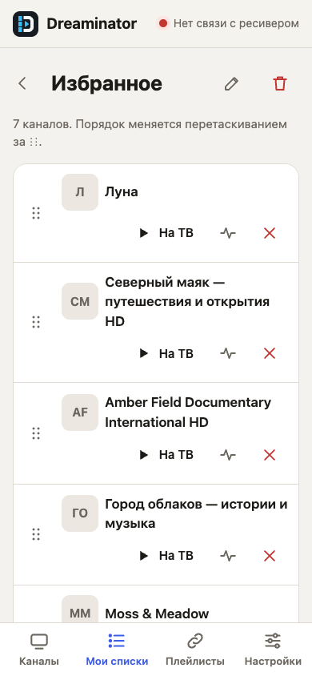
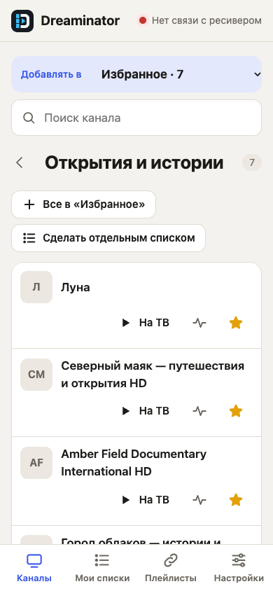
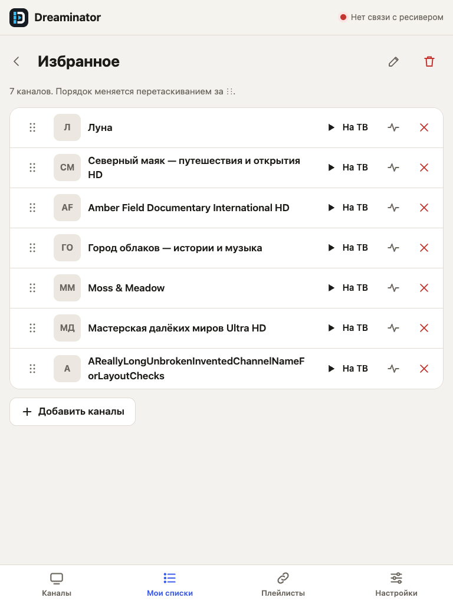
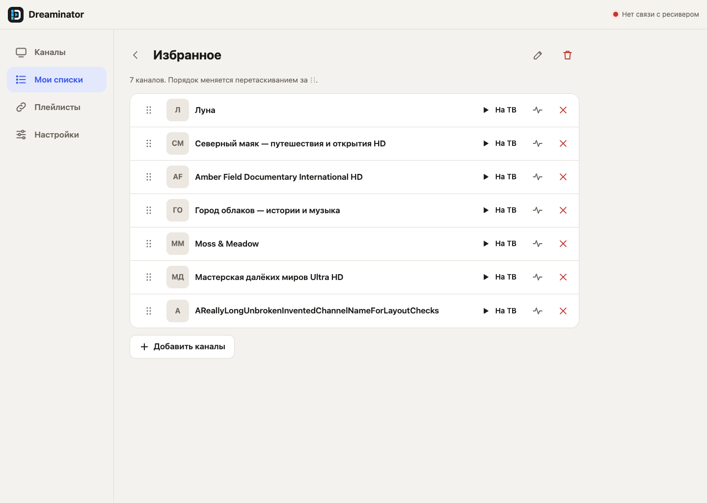

# Responsive channel lists

This focused audit and adaptation preserves the existing Russian interface, colors, typography and navigation. Captures below show the current Go service with temporary invented channel and playlist fixtures. Receiver access and nightly refresh are disabled; the offline receiver indicator is expected.

## Findings and changes

| Surface | Observed problem | Result |
| --- | --- | --- |
| Phone, 360/390 px | Favorites left only 6/36 px for a channel name because the handle, logo and three actions shared one flex row. | Names wrap in their own area; actions sit below at 48 px touch size. The drag handle remains separate from page scrolling. |
| Tablet, 768/1024 px | Long channel names were truncated despite usable vertical space. | Compact rows remain, with wrapping names and grouped actions. |
| Desktop, 1440 px | Channel controls had inconsistent playback labels; handles were unavailable to keyboard users. | Playback says “На ТВ” in both channel views. Handles accept Up/Down arrows and retain focus after saving. |
| Shared | Long group/action/source labels could exceed their container. The floating send panel could cover the last action after editing. | Labels wrap; bottom space follows the actual panel height. Navigation has visible keyboard focus and an active-page state; favorite buttons expose their selected state. |

No provider configuration or receiver/plugin behavior is changed.

## Verification

- `make test`, `make plugin-unit`, `make ipk ipk-vuuno4kse`, `python3 tools/check_packages.py`.
- `make web-test`: real Go service and isolated Chromium; Channels, My lists, Sources, Settings, empty lists and missing channels at all five widths. Checks geometry, touch target sizes, favorites, search, probe error handling, saved pointer/keyboard order, retained focus and access to the final action above the send panel.
- The regression failed against the original interface with `title only 6px at 360px` before the layout fix.
- Synthesized Chromium touch input also verified persisted drag order, page scrolling outside the handle, and cancellation of a drag.
- Impeccable's source detector reported no findings for the changed UI files. Light and dark views were inspected visually.

Physical iOS/Android devices, Safari and actual receiver playback were not tested. Chromium viewport emulation and synthesized touch do not certify those platforms. To reproduce screenshots, see [the development guide](development.md).

## Rendered screenshots

Phone, 390 × 844:

Channels on a phone, 390 × 844:

Tablet, 768 × 1024:

Desktop, 1440 × 1024:

