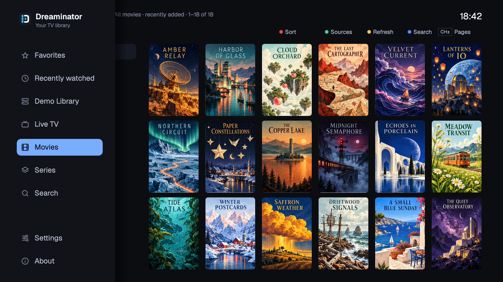
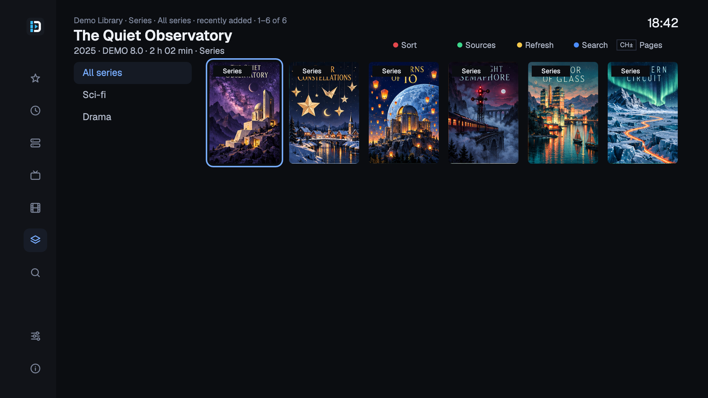
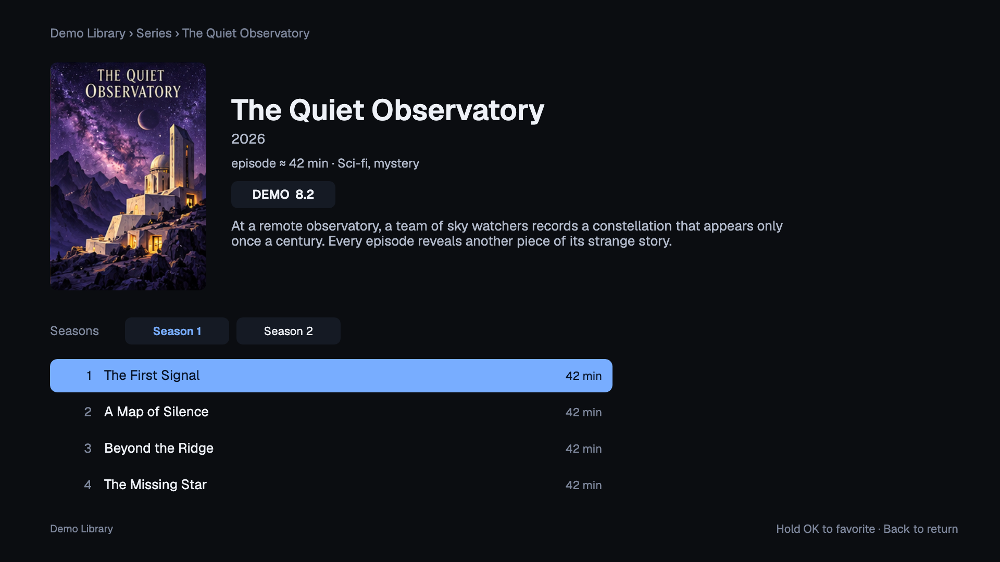
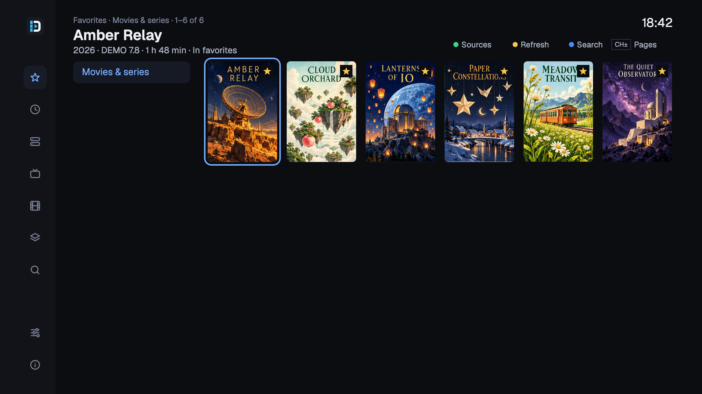
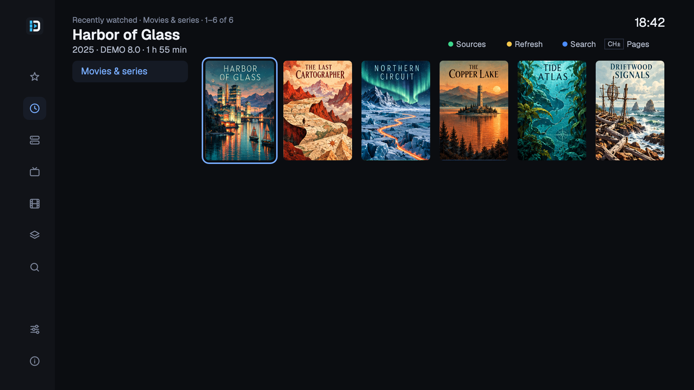
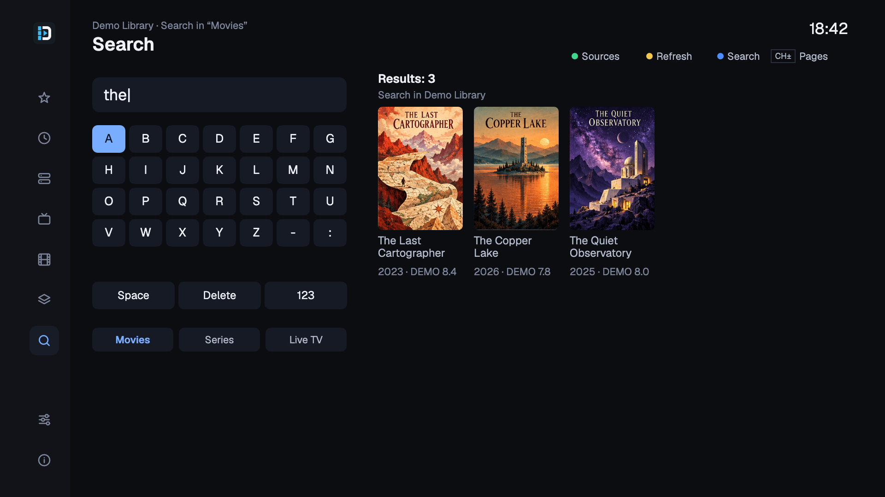
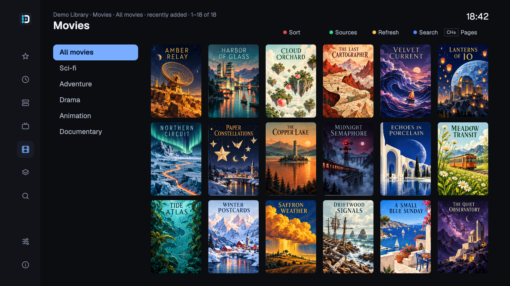
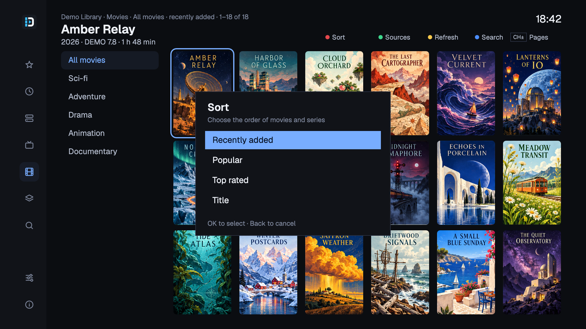

# A look around Dreaminator

[README](../README.md) · [Installation](installation.md) · [Remote controls](features.md#remote-control)

Here are a few views of the TV interface. Click an image to open it at full size. These previews use English labels; the app currently uses Russian.

## Live TV

Browse your channels and see the current programme, what's coming next and more information on the right.

Move left to expand the navigation and switch between your sources, favorites, live channels and library.

## Movies and series

Browse the posters, open a film for its description, or choose a season and episode. Movies and series are currently available from Stalker/Ministra portals.

## Favorites and search

Hold OK to save something to Favorites. Recently watched keeps the items you've opened, so they're easy to find again.

Use the on-screen keyboard to search your current source. You can switch between Russian, English and numbers.

Browse a category or press the red button to change the order of films and series.

[Back to README](../README.md) · [Set up your receiver](installation.md)
